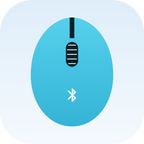
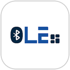

### Nurullah Al-Masum

  
  
  
  

Native and cross-platform app developer in Bangladesh. I build Android apps in Kotlin and Java, and apps for Android and iOS in Flutter. When a project needs more than the app, I build that too: the web side in Next.js, desktop builds, and the Bluetooth link to an ESP32 or Arduino.

I've been shipping apps for about four years, for freelance clients and at GizanTech in Dhaka, where I also teach mobile development. One of those, a Bluetooth walkie-talkie app, has passed 100,000 installs. My own apps are published under [EazyVerse](https://eazyverse.com).

**What I work on**

- **Mobile:** native Android (Kotlin, Java, Jetpack Compose) and Flutter for Android and iOS
- **Web:** Next.js and React front ends, with Node.js or Firebase behind them
- **IoT:** apps that talk to ESP32, Arduino and HC-05 modules over Bluetooth Classic and BLE
- **Desktop:** Flutter apps for Windows, macOS and Linux

**My apps on Google Play**

  &nbsp;
  &nbsp;
  &nbsp;
  &nbsp;
  &nbsp;
  

[Bluefy](https://play.google.com/store/apps/details?id=com.eazyverse.bluefy) &nbsp;·&nbsp; [Sound Scheduler](https://play.google.com/store/apps/details?id=com.eazyverse.soundscheduler) &nbsp;·&nbsp; [ListKin](https://play.google.com/store/apps/details?id=com.eazyverse.listkin) &nbsp;·&nbsp; [Value Guard](https://play.google.com/store/apps/details?id=com.eazyverse.valueguard) &nbsp;·&nbsp; [TestTrack](https://play.google.com/store/apps/details?id=com.eazyverse.testtrack) &nbsp;·&nbsp; [Ember](https://play.google.com/store/apps/details?id=com.eazyverse.ember)

**Built at GizanTech**

  &nbsp;
  &nbsp;
  &nbsp;
  

[Walkie Talkie](https://play.google.com/store/apps/details?id=com.gizantech.blu_walkie_talkie) &nbsp;·&nbsp; [MikoPhone](https://play.google.com/store/apps/details?id=com.gizantech.mikophone) &nbsp;·&nbsp; [BLE Scanner](https://play.google.com/store/apps/details?id=com.gizantech.blu_scanner) &nbsp;·&nbsp; [Outback Comms Fusion](https://play.google.com/store/apps/details?id=com.au.outbackcomms.fusionapp)

**Built for clients**

  

[eKIMAT](https://play.google.com/store/apps/details?id=com.ekimat.app) for Samu Impex

**Open source**

- [excel_plus](https://pub.dev/packages/excel_plus): read, write and style Excel files in Dart and Flutter
- [csv_plus](https://pub.dev/packages/csv_plus): fast CSV parsing, encoding and validation for Dart
- [flutter_classic_bluetooth](https://pub.dev/packages/flutter_classic_bluetooth): Bluetooth Classic serial for Flutter on five platforms
- [virtual_keypad](https://pub.dev/packages/virtual_keypad): on-screen keyboard for kiosk, POS and TV apps

Have an app to build? Reach me on [Freelancer](https://www.freelancer.com/u/masummsnr) or through [almasum.dev](https://almasum.dev).
